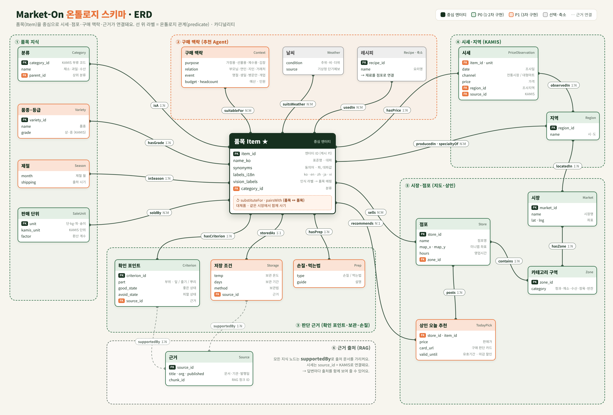

# Market-On · Ontology Architecture

> **요약** — 품목(Item)을 중심에 두고 ① 품목 지식 ② 구매 맥락 ③ 판단 근거 ④ 시세·지역 ⑤ 시장·점포 ⑥ 근거 출처, 6개 영역을 관계(predicate)로 연결해요.
> 신청서 핵심 기능 6개가 모두 이 스키마 위에서 동작하고, 모든 지식 노드는 `supportedBy`로 출처 문서를 가리켜서 **"AI가 지어낸 말이 아니라 근거가 있는 답"**을 구조로 보여 줘요.
> 사용자가 입력하는 값과 각 값이 연결되는 노드는 **4장**에 정리했어요. 필수 입력은 사진 1장과 시장 선택 1번이에요. 구매 판단 카드는 현재 개발 범위에서 제외했어요.
> RAG 문서 구성은 별도 문서 `Market-On_RAG_Knowledge_Base.md`에 있고, 연결 방법은 **5장**에 정리했어요.
> 구현 범위: **P0**(1·2차) 품목·분류·확인 포인트·시세·판매 단위·시장·점포·근거 → **P1**(3차) 구매 맥락·상인 오늘 추천·제철·저장 조건 → **선택** 날씨·레시피

---

## 0. ERD



| 색 | 의미 |
|---|---|
| 진녹색 | 중심 엔터티 (품목) |
| 연녹색 | P0 · 1·2차(14:30~24:00) 구현 |
| 주황 | P1 · 3차(00:00~05:00) 구현 |
| 회색 | 선택·축소 |
| 점선 | 근거(출처) 연결 |

---

## 1. 온톨로지 스키마

```markdown
- 품목 (Item) ★중심 엔터티
  - 라벨: 표준명 · 동의어 · 다국어(ko/en/zh/ja/vi) · 인식 라벨(Vision label → 품목 매핑)
  - 분류 (isA) — KAMIS 부류·품목·품종 코드
  - 품종 · 등급 (hasGrade)
  - 산지 (producedIn) → 지역
  - 특산품 (specialtyOf) → 지역
  - 제철 (inSeason) → 월 · 출하 시기
  - 확인 포인트 (hasCriterion) — 부위 · 좋은 상태 · 피할 상태
  - 저장 조건 (storedAs) — 온도 · 기간 · 보관법
  - 손질 · 먹는법 (hasPrep)
  - 판매 단위 (soldBy) — 단 · kg · 개 · 송이 (KAMIS 단위 환산)
  - 대체품 (substituteFor) · 함께 사기 (pairsWith)
- 시세 (PriceObservation)
  - 품목 · 단위 · 날짜 · 조사지역 · 유통 구분(전통시장/대형마트) · 출처
- 지역 (Region)
- 시장 (Market)
  - 카테고리 구역 (Zone) — 청과·채소·수산·정육·반찬·떡/분식
  - 점포 (Store) — 미니맵 좌표 · 취급 품목(sells) · 영업시간
    - 상인 오늘 추천 (TodayPick) — 품목 · 가격 · 한 줄 소개 · 유효기간
    - 마감 할인 (선택)
  - 편의시설 (선택) — 주차장 · 화장실 · 배송
- 구매 맥락 (Context)
  - 목적: 가정용 · 선물용 · 제수용 · 김장
  - 관계: 부모님 · 연인 · 지인 · 거래처
  - 이벤트: 명절 · 생일 · 병문안 · 개업/이사 · 조문
  - 예산 · 인원(가구 규모)
  - 날씨 (suitsWeather) · 시기(명절·김장철)
- 레시피 (축소) — 재료(품목) → 같은 시장 점포로 연결 (usedIn)
- 근거 (Source) — 문서 · 기관 · 발행일 · RAG 청크 ID (supportedBy)
```

---

## 2. 관계(Predicate) 정의

| 관계 | 주어 → 목적어 | 카디널리티 | 쓰이는 기능 | 우선순위 |
|---|---|---|---|---|
| `isA` | 품목 → 분류 | N:1 | 품목 인식 결과 정규화 | P0 |
| `hasCriterion` | 품목 → 확인 포인트 | 1:N | ① 신선도 확인 포인트 | P0 |
| `hasPrice` | 품목 → 시세 | 1:N | ② 기준시세 비교 | P0 |
| `soldBy` | 품목 → 판매 단위 | N:M | ② 실제 사는 단위로 가격 환산 | P0 |
| `observedIn` | 시세 → 지역 | N:1 | ② 조사지역 표시 | P0 |
| `sells` | 점포 → 품목 | N:M | ⑥ 인식 품목 판매 점포 안내 | P0 |
| `hasZone` · `contains` | 시장 → 구역 → 점포 | 1:N | ⑥ 카테고리별 지도 | P0 |
| `supportedBy` | 지식 노드 → 근거 | N:1 | ③ 근거 제시 · 환각 억제 | P0 |
| `hasGrade` | 품목 → 품종·등급 | 1:N | KAMIS 코드 매핑 | P1 |
| `inSeason` | 품목 → 제철 | 1:N | 홈 '11월 제철' | P1 |
| `storedAs` | 품목 → 저장 조건 | 1:1 | ③ 저장 조건 | P1 |
| `hasPrep` | 품목 → 손질·먹는법 | 1:N | 결과 화면 탭 | P1 |
| `suitableFor` | 품목 → 구매 맥락 | N:M | ④ 추천 Agent(가정·선물·제수) | P1 |
| `posts` · `recommends` | 점포 → 오늘 추천 → 품목 | 1:N · N:1 | 상인 홍보 | P1 |
| `substituteFor` · `pairsWith` | 품목 ↔ 품목 | N:M | 대체품 · 같은 시장 함께 사기 | P1 |
| `producedIn` · `specialtyOf` | 품목 → 지역 | N:M | 산지 · 특산품 설명 | P1 |
| `locatedIn` | 시장 → 지역 | N:1 | 시장 위치 | P1 |
| `suitsWeather` | 품목 → 날씨 | N:M | 날씨 맞춤 (실패 시 제철로 대체) | 선택 |
| `usedIn` | 품목 → 레시피 | N:M | 재료 → 점포 연결 | 선택 |

### 응답 캐시 키
`item_id + 의도(intent) + 날짜` — "대파 값"과 "파 가격"은 동의어로 같은 `item_id`에 묶여 같은 캐시에 적중하고, 날짜가 키에 있어서 어제 시세가 나오지 않아요.

---

## 3. 단점을 장점으로 바꾸는 전략

> 적용 가능성: 작품(서류·발표·시연)에 바로 넣을 수 있는 정도 (0~10점)

| # | 단점 | 장점으로 바꾸는 표현 | 스키마 근거 | 적용 가능성 |
|---|---|---|---|---|
| 1 | 레시피가 '알뜰하게 장볼지도' AI 레시피와 겹침 | "레시피는 목적이 아니라 **같은 시장 안 여러 점포를 이어 주는 연결 고리**예요" | `usedIn` → `sells` 경로 | **9/10** |
| 2 | Cloud Vision이 세부 품목(샤인머스캣·단감 등)을 잘 구분하지 못함 | "범용 인식 라벨을 **온톨로지가 세부 품목으로 바로잡아요**. 인식 결과는 사용자가 확인·수정할 수 있어요" | `vision_labels` · `isA` | **9/10** |
| 3 | KAMIS는 시장별 가격이 아니라 조사지역 평균 | "시세를 **출처·날짜·지역이 붙은 관측값**으로 저장해서 '기준시세 대비'라고 정직하게 보여 줘요" | `PriceObservation` · `supportedBy` | **8/10** |
| 4 | KAMIS 단위가 품목마다 달라 소비자가 이해하기 어려움 | "단·송이·kg처럼 **시장에서 실제로 사는 단위로 환산**해서 보여 줘요" | `SaleUnit.factor` | **8/10** |
| 5 | AI가 신선도를 판정하지 않음 (기능이 약해 보일 수 있음) | "AI 판정은 틀리면 책임 문제가 생겨요. Market-On은 **근거가 있는 확인 포인트로 소비자가 직접 판단**하게 해요" | `Criterion` + `Source` | **9/10** |
| 6 | 시장 안 점포 데이터가 부족함 (디지털 지도 등록률 12% 미만) | "시연 시장 1곳은 직접 구축했어요. **같은 스키마로 다른 시장에도 그대로 확장**할 수 있어요" | `Market` → `Zone` → `Store` | **7/10** |
| 7 | 노드가 많아 무박 일정에 비해 범위가 큼 | "P0 8개 노드로 핵심 흐름을 먼저 완성하고, P1은 **같은 스키마에 노드만 추가**하는 확장형 설계예요" | ERD 색 구분 | **8/10** |
| 8 | 생성형 AI 답변의 환각 위험 | "모든 지식 노드가 출처를 가리켜서 **답변마다 근거 문서를 함께 보여 줘요**" | `supportedBy` · `chunk_id` | **9/10** |
| 9 | 날씨 API 실패 가능성 | "날씨를 못 받으면 **제철 관계로 자동 대체**해서 추천이 끊기지 않아요" | `suitsWeather` → `inSeason` | **6/10** |

---

## 4. 사용자 입력값 (온톨로지 연결용)

> **요약** — 소비자는 **사진 1장 + 시장 선택 1번**만 꼭 입력하면 되고, 나머지는 모두 선택 입력이에요. 입력값은 전부 온톨로지 노드 ID로 바뀌어서 지식 조회(RAG 검색 범위)와 응답 캐시 키에 쓰여요.
> 상인 입력은 P1(3차)에서 점포·오늘 추천만 받아요. 품목 지식·확인 포인트·근거 문서·시세는 사용자가 입력하지 않아요. 팀이 대회 현장에서 구축하거나 KAMIS 같은 공공데이터에서 가져와요.
> 개인정보(이름·연락처·정확한 나이·성별)는 받지 않아요. 연령대가 필요하면 선택 입력으로만 받아요.

### 4-1. 입력 원칙

1. **입력은 탭과 선택으로 받아요.** 자유 입력은 가격과 질문 두 곳뿐이에요.
2. **모든 입력값은 노드 ID로 바꿔요.** "파", "대파값", "green onion"은 모두 `item:green_onion`으로 정규화돼요.
3. **비어 있으면 기본값을 써요.** 시장을 고르지 않으면 GPS로 가장 가까운 시장, 단위가 없으면 품목의 기본 판매 단위를 써요.
4. **입력한 값은 다시 묻지 않아요.** 시장·언어·구매 목적은 세션 동안 기억해요.

### 4-2. 소비자 입력값

| # | 입력값 | 입력 방식 | 필수 | 연결 노드 | 쓰이는 기능 | 단계 |
|---|---|---|---|---|---|---|
| C1 | 상품 사진 | 카메라 촬영 / 앨범 | **필수** | `Item.vision_labels` → `Item` | ① 품목 인식 | P0 |
| C2 | 인식 결과 확인·수정 | 후보 3개 중 탭, 없으면 검색 | **필수** (신뢰도 낮을 때만 표시) | `Item.item_id` | ① 품목 확정 | P0 |
| C3 | 현재 시장 | GPS 자동 → 목록에서 확인 | **필수** (1회) | `Market` | ⑥ 점포 지도 · 시세 지역 | P0 |
| C4 | 품종 | 칩 선택 (예: 대파 / 쪽파) | 선택 | `Variety` | ② 시세 코드 매핑 | P1 |
| C5 | 수량·단위 | 칩 선택 (1단 · 1kg · 1개 · 1송이) | 선택 (없으면 기본 단위) | `SaleUnit` | ② 단위 환산 | P0 |
| C6 | 본 가격 | 숫자 키패드 | 선택 (가격 비교 시 필수) | 사용자 가격 vs `PriceObservation` | ② 기준시세 대비 | P0 |
| C7 | 점포 | 지도에서 탭 / 목록 | 선택 | `Store` | ⑥ 점포 표시 · 함께 사기 | P0 |
| C8 | 확인 포인트 체크 | 체크박스 | 선택 | `Criterion` | ① 소비자 직접 판단 | P0 |
| C9 | 질문 | 텍스트 / 음성 | 선택 | 의도(intent) + `Item` 동의어 | ③ 근거 기반 답변 | P1 |
| C10 | 구매 목적 | 칩: 가정용 · 선물용 · 제수용 · 김장 | 선택 | `Context.purpose` | ④ 추천 Agent | P1 |
| C11 | 받는 사람 | 칩: 부모님 · 연인 · 지인 · 거래처 | 선택 (선물용일 때) | `Context.relation` | ④ 추천 Agent | P1 |
| C12 | 상황 | 칩: 명절 · 생일 · 병문안 · 개업 | 선택 (선물용일 때) | `Context.event` | ④ 추천 Agent | P1 |
| C13 | 예산 | 슬라이더 (1만 ~ 10만 원) | 선택 | `Context.budget` | ④ 추천 Agent | P1 |
| C14 | 인원 | 칩: 1인 · 2인 · 3~4인 · 5인 이상 | 선택 | `Context.headcount` | ④ 추천 수량 | P1 |
| C15 | 언어 | 기기 언어 자동 → 변경 가능 | 자동 | `Item.labels_i18n` | 다국어 | P1 |
| C16 | 연령대 | 칩: 20대 이하 · 30~40대 · 50대 이상 | 선택 | `Context.age_group` | ④ 추천 표현·글자 크기 | 선택 |

### 4-3. 상인 입력값 (P1)

| # | 입력값 | 입력 방식 | 필수 | 연결 노드 | 쓰이는 기능 |
|---|---|---|---|---|---|
| M1 | 점포 선택 | 시장 지도에서 내 점포 탭 | **필수** (1회) | `Store` | 점포 인증 |
| M2 | 취급 품목 | 품목 칩 다중 선택 | **필수** (1회) | `sells` | ⑥ 인식 품목 → 점포 안내 |
| M3 | 영업시간 | 시간 선택 | 선택 | `Store.hours` | 지도 표시 |
| M4 | 오늘 추천 품목 | 취급 품목 중 탭 | 선택 | `TodayPick.item_id` | 상인 홍보 |
| M5 | 판매가 · 마감 할인가 | 숫자 키패드 | 선택 | `TodayPick.price` | 가격 표시 |
| M6 | 산지 · 한 줄 소개 | 칩 + 짧은 텍스트 | 선택 | `producedIn` · `TodayPick` | 홍보 문구 |
| M7 | 유효기간 | 시간 선택 (기본: 오늘 마감) | 자동 | `TodayPick.valid_until` | 지난 정보 자동 숨김 |

### 4-4. 사용자가 입력하지 않는 값

| 노드 | 채우는 방법 | 시점 |
|---|---|---|
| `Item` · `Category` · `Variety` · `SaleUnit` | 팀이 시연 품목 30개로 구축(RAG 문서 6-2 목록), KAMIS 코드 매핑 | 대회 현장 |
| `Criterion` · `Storage` · `Prep` | 공공 문서를 근거로 팀이 작성 | 대회 현장 (자료 조사는 사전) |
| `Source` | 근거 문서 목록 → RAG 청크 | 대회 현장 |
| `PriceObservation` · `Region` | KAMIS Open API | 자동 |
| `Market` · `Zone` · `Store` 좌표 | 전국전통시장표준데이터 · 상가정보, 시연 시장 1곳은 직접 입력 | 대회 현장 |
| `Weather` | 기상청 단기예보 | 자동 |

### 4-5. 입력값 → 온톨로지 조회 흐름 (대파 예시)

```text
C1 사진  ──Vision──▶ "green onion, scallion"
                        │  vision_labels 매핑
C2 확인  ────────────▶ item:green_onion
C3 시장  ────────────▶ market:mangwon ─ locatedIn ─▶ region:seoul
C5 단위  ────────────▶ unit:bunch (factor 1단 = 0.8kg)
C6 가격  ────────────▶ 3,500원  vs  PriceObservation(seoul, 2026-11-21) → 1단 환산 3,980원 → 12%↓
                        │
조회    item:green_onion ─ hasCriterion ─▶ 확인 포인트 3개 ─ supportedBy ─▶ Source
                        ─ sells⁻¹ ─▶ market:mangwon 안 점포 목록 (지도 강조)
캐시 키  item:green_onion + intent:price + 2026-11-21
```

### 4-6. 입력값 데이터 예시 (JSON)

```json
{
  "session": { "market_id": "market:mangwon", "lang": "ko", "age_group": null },
  "scan": {
    "photo_id": "img_20261128_001",
    "vision_labels": ["green onion", "scallion"],
    "item_id": "item:green_onion",
    "confirmed_by_user": true,
    "variety_id": null,
    "unit": "unit:bunch",
    "seen_price": 3500,
    "store_id": "store:mangwon-B03",
    "criteria_checked": ["c:go-leaf", "c:go-stem", "c:go-root"]
  },
  "context": {
    "purpose": "home", "relation": null, "event": null,
    "budget": 30000, "headcount": 2
  }
}
```

### 4-7. 단점을 장점으로 바꾸는 방법 (입력)

| 단점 | 장점으로 바꾸는 표현 | 적용 가능성 |
|---|---|---|
| 사용자가 입력해야 할 항목이 많아 보임 | "필수는 **사진 1장과 시장 선택 1번**이에요. 나머지는 탭으로 고르고, 고르지 않으면 기본값을 써요" | **9/10** |
| 인식이 틀려 사용자가 고쳐야 함 | "인식 결과를 **사용자가 확정하는 단계**를 둬서 틀린 정보로 판단하지 않게 해요. 고친 값은 인식 라벨 매핑을 보강해요" | **9/10** |
| 개인 맞춤 정보(나이·성별)를 받지 않음 | "**개인정보 없이** 구매 목적·인원·예산만으로 추천해요. 서약서의 개인정보 기준도 지켜요" | **8/10** |
| 상인이 앱에 익숙하지 않을 수 있음 | "상인 입력은 **처음 1회(점포·취급 품목)와 탭 몇 번**이면 끝나요. 오늘 추천은 30초면 올릴 수 있어요" | **7/10** |
| 사용자가 가격을 직접 넣어야 비교됨 | "가격표를 본 그 자리에서 **숫자만 누르면 기준시세 대비가 바로** 나와요. 가격을 입력하지 않으면 기준시세만 보여 줘요" | **8/10** |

### 4-8. 입력 설계 루브릭

| 기준 | 배점 | 점수 | 근거 |
|---|---|---|---|
| 창의성 | 20 | 16 | 사진 한 장으로 온톨로지 노드 ID가 정해지는 흐름 |
| 기술성 | 20 | 17 | 입력값 정규화 → 노드 ID → RAG 검색 범위·캐시 키로 이어짐 |
| 완성도 | 30 | 24 | P0 필수 입력이 3개뿐이라 무박 일정 안에 끝까지 구현할 수 있음 |
| 활용성 | 20 | 17 | 상인 입력이 쌓이면 다른 시장으로 확장 가능 |
| 발표·협업 | 10 | 8 | 4-5 흐름도로 시연 설명 가능 |
| **합계** | **100** | **82** | 보완: 연령대(C16)는 실제로 쓰는 곳을 정하지 못하면 빼요 |

> **참고 — 구매 판단 카드:** 현재 개발 범위에서 제외했어요. 시안(`카드_소비자공유.png`, `카드_상인오늘추천.png`)과 템플릿은 폴더에 보관해 두고, 일정에 여유가 생기면 다시 넣어요.

---

## 5. RAG 연결

> 자세한 문서 목록·출처·청크 규칙은 [`Market-On_RAG_Knowledge_Base.md`](./Market-On_RAG_Knowledge_Base.md)에 있어요.

- **역할 구분:** 온톨로지는 짧은 사실 값과 관계를, RAG는 이유·맥락·시장 이야기 같은 긴 글을 담아요.
- **연결 방법:** 모든 지식 노드는 `supportedBy`로 `Source`를 가리키고, RAG 청크 메타데이터의 `item_id` · `node_type`은 이 문서의 노드 이름과 똑같이 써요.
- **검색 순서:** 질문 → 온톨로지 정규화(`item_id` + 의도) → 메타데이터 필터로 범위 축소 → 벡터 검색 → 출처 표시 → 캐시 저장
- **추가 노드:** RAG 확장에 맞춰 `OriginTip`(원산지 구별), `SafetyNote`(안전 주의)를 품목에 연결해요. (ERD 반영 예정)

---

## 6. 루브릭 자체 점검 (스키마 기준)

| 기준 | 배점 | 보완 전 | 보완 후 | 근거 |
|---|---|---|---|---|
| 창의성 | 20 | 13 | 17 | 상인 오늘 추천·구매 맥락(제수용·병문안)으로 전통시장 특화 |
| 기술성 | 20 | 11 | 17 | 근거 노드로 RAG 근거 제시·환각 억제를 구조로 증명 |
| 완성도 | 30 | 18 | 26 | 인식 → 품목 → 점포 흐름이 끊김 없이 연결 |
| 활용성 | 20 | 14 | 18 | 같은 스키마로 다른 시장 확장 가능 |
| 발표·협업 | 10 | 6 | 8 | ERD 한 장으로 설명 가능 |
| **합계** | **100** | **62** | **86** | |

### 남은 보완점
- 시연 시장 1곳의 점포 데이터(`Store`, `sells`)를 대회 전에 확인해요. 데이터 조사까지는 사전 준비로 허용돼요.
- `Criterion`(확인 포인트)의 근거 문서 목록(기관·발행일)을 미리 정리해 두면 `Source` 노드를 바로 채울 수 있어요.
- 다국어 라벨은 시연 품목 5~10개만 먼저 채워요.