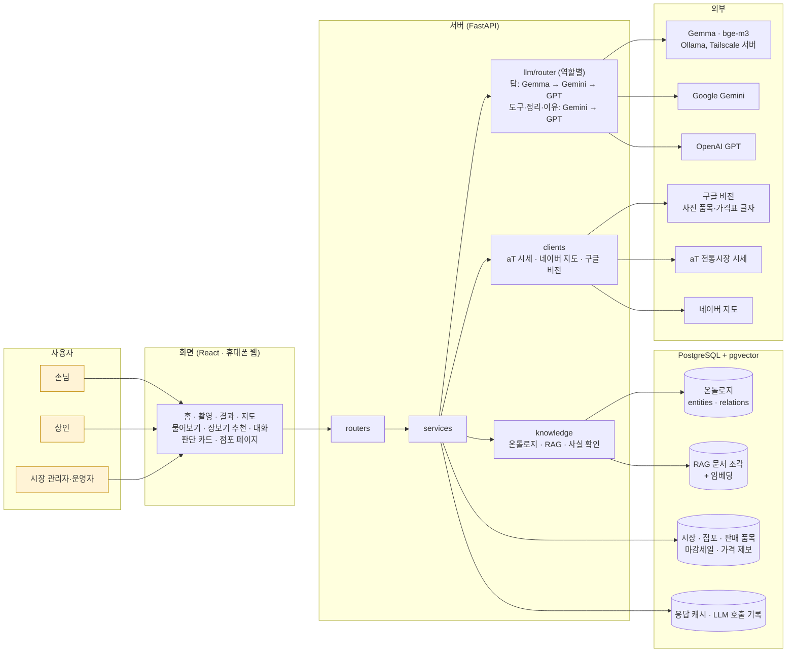
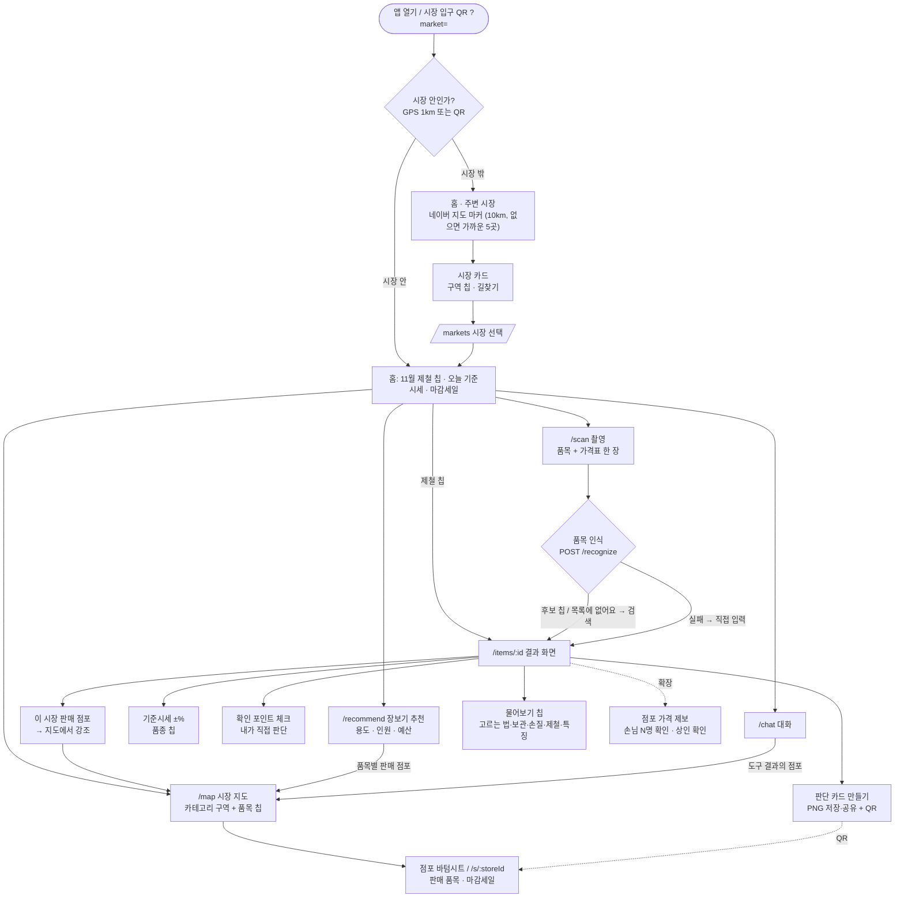
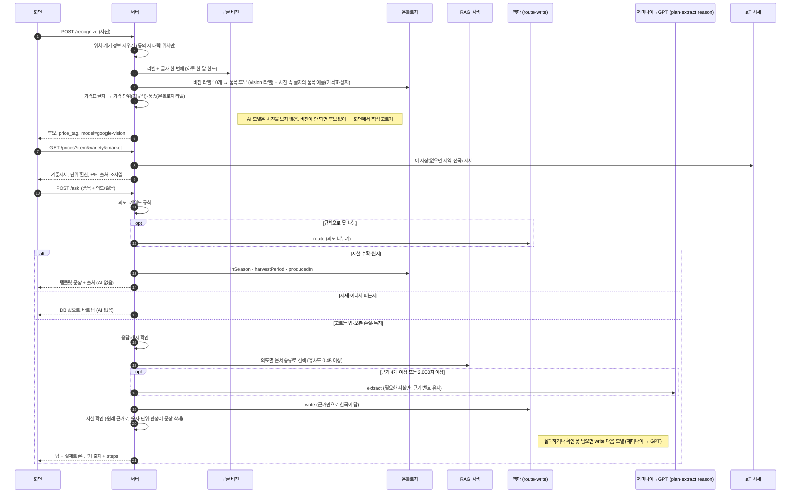
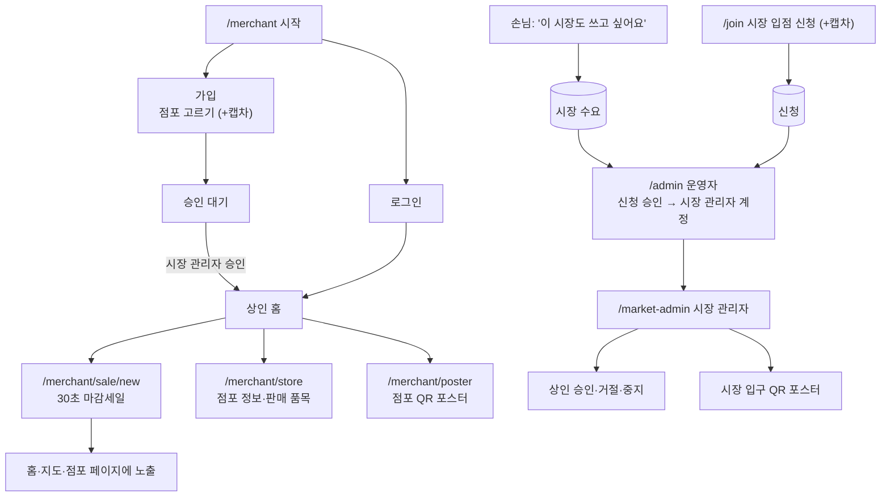
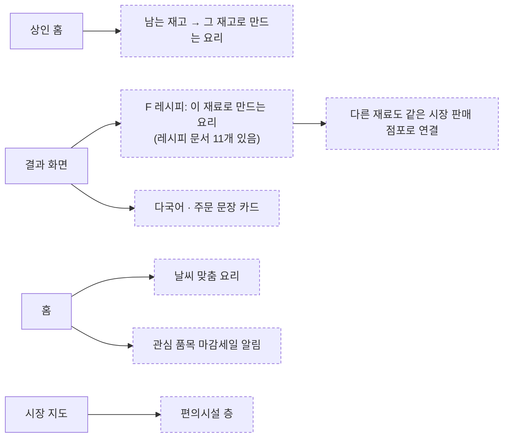

# 08. 서비스 흐름도

> 상태: **[확정]** 지금 코드 기준 (2026-11-26, main `70431a7`) · 5장만 **[제안]**
> 그림은 Mermaid라 GitHub·VS Code에서 바로 보여요.

---

## 1. 한눈에 보는 구조

- **원칙**: AI는 등급을 매기지 않아요. 숫자(시세·수량·제철)는 코드와 온톨로지가 만들고, AI는 근거 문장을 고르고 말로 풀기만 해요.
- **데이터 원본**: `data/ontology/*.yaml`, `data/rag_docs/`, `data/markets/gyeongdong.yaml` → 적재 스크립트 → DB.

---

## 2. 손님 흐름 (주 기능: "이 품목, 이 시장 어디서 팔아요?")

---

## 3. 결과 화면 안에서 일어나는 일 (요청별)

작업 지시서 040 (2026-11-27): 사진 품목 인식은 **구글 비전만**, 젬마는 **헤드 에이전트(최종 한국어 답)**, 제미나이 → GPT는 젬마가 맡기는 일(도구 고르기·긴 근거 정리·장보기 이유·실패 시 대신 답하기).

- **장보기 추천** `POST /recommend`: 품목·수량·가격은 코드가 계산 → reason(제미나이 → GPT → 젬마)은 이유 문장만 → 사실 확인.
- **대화** `POST /chat`: plan(제미나이 → GPT)이 도구 6개(품목 찾기·기준시세·판매 점포·마감세일·지식 질문·장보기 구성)를 최대 4번 부름 → write(젬마)가 도구 결과로 한국어 답 → 도구 결과와 대조 → 실패하면 write 다음 모델, 그래도 안 되면 plan 모델의 답을 같은 검사로.
- **기다리는 동안**: 답은 사실 확인 뒤 한 번에 와서 글자 스트리밍은 안 해요. 화면은 "근거 찾는 중 → 정리 중 → 답 쓰는 중"을 차례로 보여 주고, 응답의 `steps`에 실제로 거친 단계가 와요.
- **기록**: 모든 호출은 `llm_calls`에 역할(`role`: route·plan·extract·write·reason·vision)과 모델로 남아요. 발표 때 "최종 답(write)의 몇 %를 젬마가 썼나"를 여기서 셉니다.

---

## 4. 상인 · 시장 관리자 · 운영자 흐름

- **캡차 화면**은 신태빈 님 담당이에요. 지금은 가입과 `/join`이 서버에서 막혀 있어요.

---

## 5. 남은 작업이 붙는 자리 **[제안]**

| 순서 | 작업 | 흐름에서 바뀌는 곳 |
|---|---|---|
| 1 | 고정 주소 배포 (이름 있는 Cloudflare 터널) | 1장 바깥: 네이버 지도 도메인 한 번만 등록 → 시장 밖 지도가 목록 대신 지도로 보임 |
| 2 | 개발용 DB 정리 | 2장 시장 선택에서 시험 시장·시험 계정이 사라짐 |
| 3 | 레시피 화면 (F) | 3장 `/ask`에 `recipe` 의도 추가 + 결과 화면 새 섹션 |
